# Griductive Solver - Workflow, Hợp đồng Biên và Luồng Xử lý

Tài liệu này mô tả workflow kỹ thuật được thống nhất từ `Analysis_Report.md`,
`Process.md`, `Audit_Report.md` (nhánh `docs/audit-team-lead`) và yêu cầu trong `AI - Project 2.pdf`.
Mục tiêu là thống nhất luồng dữ liệu giữa các tầng, hợp đồng biên giữa 5 thành viên
và cách giao diện Desktop `PyQt6` gọi qua `GameSession` (`app/session.py`).

## 1. Phạm vi và nguyên tắc bất biến

Griductive Solver giải puzzle trên lưới `N x N`, với `N` thuộc `{3, 4, 5}`.
Mỗi ô là một nhân vật có trạng thái `CRIMINAL` hoặc `INNOCENT`. Clue luôn đúng,
nhưng chỉ được lộ nếu nằm trong `initially_revealed` ($KB_0$) hoặc sau khi verdict
của ô được chứng minh bởi knowledge base hiện tại.

Các nguyên tắc bắt buộc:

1. Logic Agent chỉ nhận `PublicState` / `PublicKnowledge`: clue đã lật và verdict đã
   chứng minh. Agent không import `engine`, không đọc `solution` ẩn và không đọc
   danh sách thẻ đang úp.
2. CNF được sinh tự động từ clue, không hard-code riêng cho từng puzzle.
3. Semantic evaluator (`clues/`, Minh) độc lập hoàn toàn với encoder (`encoding/`, Tân)
   để kiểm thử chéo thực chất.
4. Biến nhân vật `C_i` và biến phụ `auxiliary` được cấp phát tách biệt trong `VarMap`.
5. Agent chỉ kết luận khi trạng thái bị ép bởi entailment theo chuẩn 2 truy vấn (§3.4);
   tuyệt đối không đoán từ một model thỏa tùy ý và không nhầm `TIMEOUT` thành `UNSAT`.
6. Giao diện `PyQt6` chỉ làm việc qua `GameSession` và `PublicState` / dataclass công khai;
   không bao giờ chạm trực tiếp `solution` hay clue chưa reveal.

## 2. Kiến trúc và dependency flow

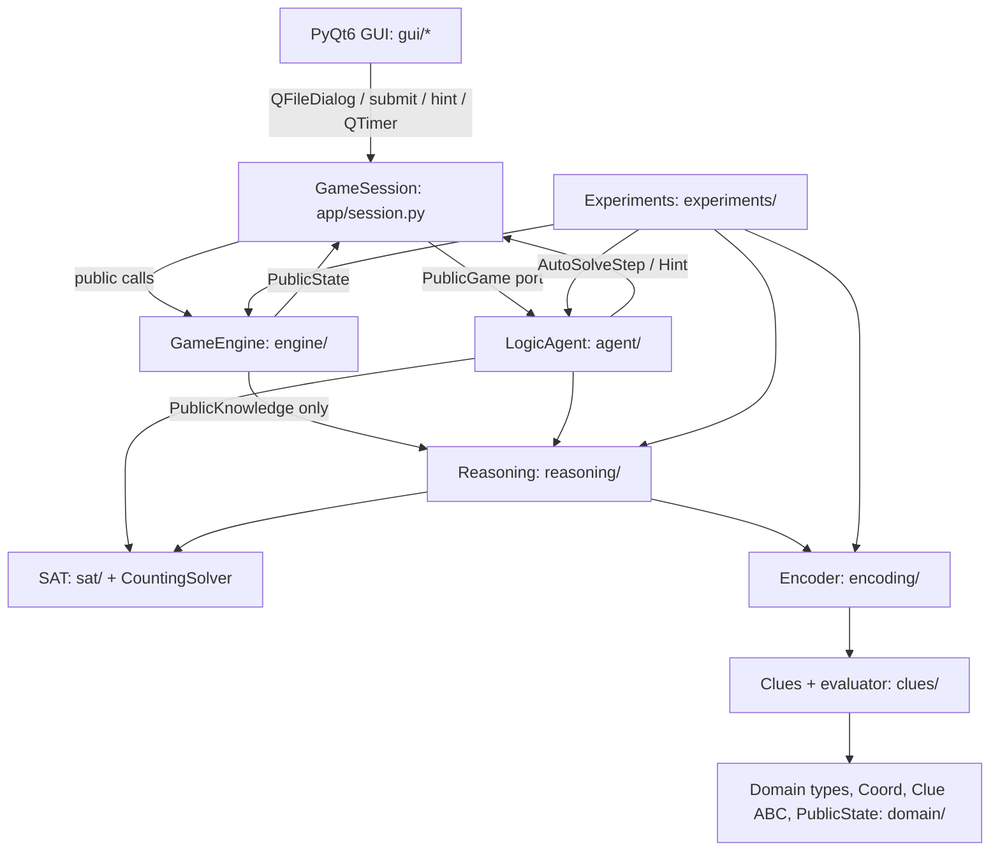

Luồng phụ thuộc một chiều (DAG, không vòng):

```text
domain (types, grid, regions, clue, public_state, errors)
  ▲              ▲
  │        clues (base re-export, core, extensions, parser, validator)
  │              ▲
  ├────── encoding (stats, varmap, cardinality, clue_encoders, encoder)
  │         ▲                        ▲
  └──── reasoning (knowledge, kb_builder, entailment, uniqueness) ◄── sat (cnf, stats, solver, dpll)
            ▲                          ▲                                      ▲
            │                          └──────── agent (ports, trace, hint, logic_agent)
            │                                                   ▲
          engine (puzzle, loader, game_engine)                  │
            ▲                                                   │
            └──────────────── app/session.py (GameSession) ─────┘
                                       ▲
                                 gui (PyQt6) / experiments / main
```

- `sat/` thuần số nguyên, không import `domain/` hay `clues/`.
- `domain/` không import `clues/` (`Clue` ABC đặt ngay tại `domain/clue.py`).
- `reasoning/` không import `agent/` (`classify` nhận `SatSolver` Protocol từ `sat/solver.py`).
- `agent/` không bao giờ import `engine/`, chỉ nhận `PublicGame` (`agent/ports.py`).
- `GameEngine` thực thi cấu trúc `PublicGame` mà không import `agent/`.
- `app/session.py` tách khỏi `engine/` (do Gia Hưng phụ trách duy nhất cùng `engine/` và `gui/`).

## 3. Cấu trúc thư mục chuẩn

```text
StudentID1_StudentID2_.../
├── Report.pdf
└── Source/
    ├── main.py
    ├── pytest.ini                  # pythonpath = ., testpaths = tests
    ├── README.md
    ├── requirements.txt            # PyQt6>=6.6, pytest>=8.0
    ├── griductive/
    │   ├── domain/
    │   │   ├── errors.py
    │   │   ├── types.py
    │   │   ├── grid.py
    │   │   ├── regions.py
    │   │   ├── clue.py             # Clue ABC (id, owner, clue_type, cells, evaluate)
    │   │   └── public_state.py     # PublicCell, PublicState, VerdictOutcome
    │   ├── clues/
    │   │   ├── base.py             # re-export Clue từ domain.clue
    │   │   ├── core.py             # Minh: Fact, Same, Different, Exactly, AtLeast, AtMost
    │   │   ├── extensions.py       # Minh: Parity, Compound (≥2; CompareCount tùy chọn)
    │   │   ├── validator.py        # Tân: kiểm tra k, region, tham chiếu
    │   │   └── parser.py           # Tân: dict/JSON -> Clue
    │   ├── sat/
    │   │   ├── stats.py            # SolverStats
    │   │   ├── cnf.py              # Literal, Clause, SatStatus, CNF, SatResult
    │   │   ├── solver.py           # SatSolver Protocol + CountingSolver
    │   │   └── dpll.py             # DPLLSolver.solve(cnf, assumptions, deadline)
    │   ├── encoding/
    │   │   ├── stats.py            # EncodingStats
    │   │   ├── varmap.py           # VarMap
    │   │   ├── cardinality.py      # direct estimate <= threshold + sequential counter
    │   │   ├── clue_encoders.py
    │   │   └── encoder.py          # Encoder.encode(clues) -> (CNF, EncodingStats)
    │   ├── reasoning/
    │   │   ├── knowledge.py        # PublicKnowledge
    │   │   ├── kb_builder.py       # build_kb_cnf() -> (CNF, VarMap, EncodingStats)
    │   │   ├── entailment.py       # SatQuery, ClassifyOutcome, check_kb_consistent, classify
    │   │   └── uniqueness.py       # UniquenessOutput, check_uniqueness
    │   ├── agent/
    │   │   ├── ports.py            # PublicGame Protocol
    │   │   ├── trace.py            # TraceSatQuery, TraceStep, SolveTrace
    │   │   ├── hint.py             # Hint, suggest_hint
    │   │   └── logic_agent.py      # AutoSolveStep, LogicAgent (bọc CountingSolver, iter_steps, run)
    │   ├── engine/
    │   │   ├── puzzle.py
    │   │   ├── loader.py           # schema + khớp solution nhanh (không chạy uniqueness ở GUI load)
    │   │   └── game_engine.py      # GameEngine (thỏa PublicGame không import agent/)
    │   ├── app/
    │   │   └── session.py          # GameSession mỏng (chủ duy nhất: Gia Hưng)
    │   ├── gui/                    # Desktop PyQt6
    │   │   ├── app.py
    │   │   ├── board_view.py
    │   │   ├── clue_panel.py
    │   │   ├── controls.py
    │   │   └── assets/
    │   └── experiments/
    │       ├── validate_puzzle.py  # CLI offline: uniqueness + giải được không đoán
    │       ├── runner.py
    │       ├── metrics.py
    │       └── export.py
    ├── puzzles/
    │   ├── 3x3/
    │   ├── 4x4/
    │   └── 5x5/
    ├── results/
    └── tests/
        ├── oracle.py               # vét cạn 2^(N^2) phép gán biến chính qua clue.evaluate()
        ├── test_dpll.py
        ├── test_encoder_vs_eval.py
        ├── test_entailment.py
        ├── test_uniqueness.py
        └── test_isolation.py       # AST tĩnh + dynamic MockGame
```

Các file `.py` nghiệp vụ được triển khai dần theo bảng phân công trong `Process.md`;
các file biên dùng chung giữ hợp đồng chặt chẽ ở phần dữ liệu và chữ ký hàm dưới đây.

## 4. Hợp đồng dữ liệu chung

### 4.1. Kiểu dữ liệu & Enums chính

| Kiểu | Vị trí | Giá trị / Trường chính | Ý nghĩa |
|---|---|---|---|
| `Status` | `domain/types.py` | `CRIMINAL`, `INNOCENT` | Trạng thái một ô |
| `SatStatus` | `sat/cnf.py` | `SAT`, `UNSAT`, `TIMEOUT` | Kết quả thuần DPLL |
| `Classification` | `domain/types.py` | `CRIMINAL`, `INNOCENT`, `UNKNOWN`, `INCONSISTENT`, `TIMEOUT` | Kết quả entailment |
| `VerdictResult` | `domain/types.py` | `ACCEPTED`, `NOT_PROVABLE`, `CONTRADICTED`, `ALREADY_REVEALED` | Kết quả nộp verdict |
| `SolveStatus` | `domain/types.py` | `RUNNING`, `SOLVED`, `STUCK`, `INCONSISTENT`, `TIMEOUT` | Trạng thái auto-solve/thí nghiệm (bỏ `FAILED`) |
| `UniquenessResult` | `domain/types.py` | `UNIQUE`, `MULTIPLE`, `UNSAT`, `TIMEOUT` | Kết quả uniqueness check |
| `SatQuery` / `ClassifyOutcome` | `reasoning/entailment.py` | `SatQuery(var_id, assumed_literal, status)`, `ClassifyOutcome(classification, queries)` | Truy vấn & kết quả entailment |
| `TraceSatQuery` / `TraceStep` | `agent/trace.py` | `TraceSatQuery(coord, assumed_status, status)`, `TraceStep(..., active_clue_ids, sat_queries, ...)` | Nhật ký truy vấn đầy đủ (PDF §4.4) |
| `AutoSolveStep` | `agent/logic_agent.py` | `(step, public_state, trace)` | Sự kiện yield từ `iter_steps` & `GameSession.auto_solve_steps` |

Coordinate dùng chuỗi như `A1`, `B2`, `C3` (lưới `N x N`, `A..` từ trái sang phải, `1..N` từ trên xuống dưới).
`row-major` là thứ tự cố định để ánh xạ biến chính:

```text
var_id(A1) = 1
var_id(B1) = 2
...
var_id(A2) = N + 1
```

Biến phụ bắt đầu sau `N * N` và chỉ được `VarMap` cấp phát; không được trùng biến nhân vật.

### 4.2. Schema puzzle JSON

```json
{
  "id": "p01",
  "size": 3,
  "initially_revealed": ["A1"],
  "characters": [
    {"cell": "A1", "name": "Abel", "job": "Detective"}
  ],
  "solution": {
    "A1": true,
    "B1": false
  },
  "clues": [
    {
      "id": "clue-01",
      "owner": "A1",
      "type": "EXACTLY",
      "region": {"kind": "row", "index": 1},
      "k": 1
    }
  ]
}
```

`solution` chỉ được loader và engine giữ trong bộ nhớ; `PublicState` không bao giờ chứa `solution` hay clue chưa reveal.
Puzzle hợp lệ phải thỏa:

- đúng `size * size` ô và nhân vật;
- mỗi ô có đúng một clue với ánh xạ 1-1 `owner` hợp lệ;
- `initially_revealed` khác rỗng (hoặc tạo thành $KB_0$ khởi đầu hợp lệ), mọi phần tử nằm trong lưới;
- mọi clue/region/`k` hợp lệ và `clue.evaluate(solution) == True`;
- qua kiểm tra uniqueness (`UniquenessResult.UNIQUE` trên biến chính) + giải được không đoán khi chạy `experiments/validate_puzzle.py` offline.

## 5. Workflow tổng thể từ input đến output

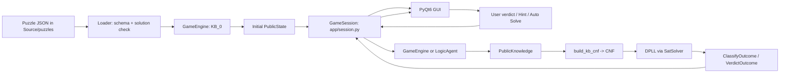

GUI `PyQt6` không gọi thẳng `DPLL`, `Puzzle.solution` hay thuộc tính nội bộ của engine.
GUI chỉ gọi `GameSession` và vẽ lại màn hình theo `PublicState`, `VerdictOutcome`, `Hint`, hoặc `AutoSolveStep` trả về.

## 6. Workflow và I/O của từng chức năng

### 6.1. Load puzzle nhanh & Validate offline

**Runtime (`engine/loader.py`):** đọc JSON, parse coordinate, dựng `Clue` qua `clues/parser.py`, kiểm tra schema, ánh xạ 1-1 `owner`, `initially_revealed` và `clue.evaluate(solution) == True`. Không chạy SAT uniqueness trong lúc GUI mở file để tránh treo màn hình trên lưới `5x5`.

**Offline (`experiments/validate_puzzle.py`):** chạy ngoài runtime GUI để kiểm tra trọn vẹn bộ puzzle bằng `check_uniqueness(...) -> UniquenessResult.UNIQUE` và chạy thử `LogicAgent` xác nhận giải được không đoán.

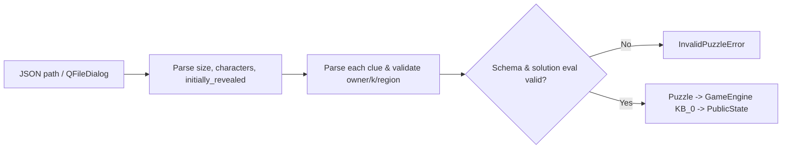

Nút **Load** trên GUI mở `QFileDialog` (thư mục mặc định `Source/puzzles/`), gọi `GameSession.load_puzzle(path)` và nhận `PublicState` khởi tạo $KB_0$ (hoặc bắt `InvalidPuzzleError` để hiện thông báo lỗi gọn).

### 6.2. Parse clue và semantic evaluator

**Module:** `domain/clue.py` (ABC `Clue`), `clues/base.py` (re-export), `clues/core.py` & `clues/extensions.py` (Minh giữ `evaluate()`), `clues/parser.py` & `clues/validator.py` (Tân giữ parser/validator).

Mỗi clue kế thừa `Clue(ABC)` (`id`, `owner`, `clue_type`, không mang trường `text`) và triển khai:

```python
clue.cells() -> tuple[Coord, ...]
clue.evaluate(assign: Mapping[Coord, bool]) -> bool
```

Evaluator không gọi encoder. Nó tính trực tiếp ngữ nghĩa clue trên phép gán
Boolean, nhờ đó có thể dùng làm oracle trong `test_encoder_vs_eval.py` (do tác giả
`evaluate()` và tác giả `encoding/` là hai người khác nhau).

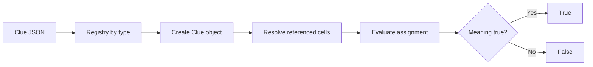

Các clue core:

| Type | Input chính | Evaluator |
|---|---|---|
| `FACT` | `cell`, `status` | `assign[cell] == status` |
| `SAME` | `left`, `right` | Hai Boolean bằng nhau |
| `DIFFERENT` | `left`, `right` | Hai Boolean khác nhau |
| `EXACTLY` | `k`, `region` | `sum(assign[c]) == k` |
| `AT_LEAST` | `k`, `region` | `sum(assign[c]) >= k` |
| `AT_MOST` | `k`, `region` | `sum(assign[c]) <= k` |

Extension chốt triển khai chắc chắn **2 loại bắt buộc** trước:

- `PARITY`: số Criminal trong vùng là chẵn/lẻ;
- `COMPOUND`: AND/OR/NOT của các clue con.

*(Mở rộng tùy chọn nếu còn thời gian: `COMPARE_COUNT` — so sánh số Criminal giữa `region_left` và `region_right`.)*

### 6.3. Sinh region

**Module:** `domain/regions.py`

**Input:** kích thước lưới và mô tả vùng.

**Output:** tuple coordinate không trùng nhau, nằm trong lưới.

```mermaid
flowchart LR
    A[Region spec] --> B{kind}
    B -- row --> C[row(index)]
    B -- column --> D[column(index)]
    B -- neighbors --> E[8 directions - center]
    B -- explicit --> F[explicit cells]
    C --> G[Bounds + duplicate check]
    D --> G
    E --> G
    F --> G
    G --> H[tuple Coord]
```

### 6.4. Ánh xạ biến `VarMap`

**Module:** `encoding/varmap.py`

**Input:** kích thước lưới, coordinate, yêu cầu biến phụ.

**Output:** ID biến chính cho từng ô và ID biến phụ mới.

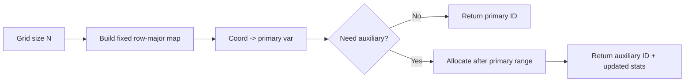

Không được cấp phát biến ngẫu nhiên theo thứ tự dictionary. Map cố định giúp
trace, DIMACS, báo cáo và test có kết quả tái lập.

### 6.5. Encode clue thành CNF

**Module:** `encoding/clue_encoders.py`, `encoding/encoder.py`.

**Input:** danh sách `Clue`, `VarMap`.

**Output:** `CNF` và `EncodingStats` gồm `primary_vars`, `aux_vars`, `clauses`.

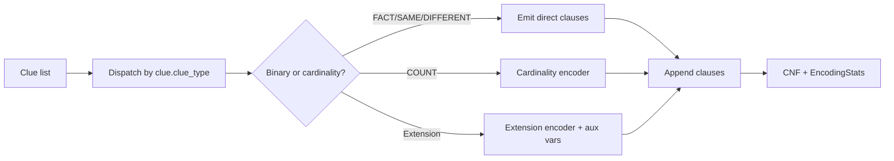

Ví dụ `DIFFERENT(A1, B1)`:

```text
(C_A1 OR C_B1) AND (NOT C_A1 OR NOT C_B1)
```

Với `EXACTLY(k, R)`, có thể dùng direct encoding cho vùng nhỏ. Với vùng lớn
hoặc `COMPARE_COUNT`, dùng sequential counter/totalizer để tránh liệt kê toàn
bộ `2^|R|` phép gán.

### 6.6. Cardinality encoding

**Module:** `encoding/cardinality.py`

**Input:** danh sách literal chính, `k`, loại ràng buộc, và `direct_threshold` (mặc định `64`).

**Output:** các clause CNF và các auxiliary literal nếu cần.

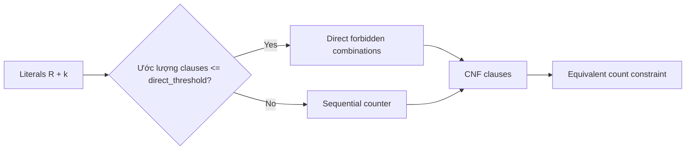

Kiểm chứng bắt buộc: với mọi assignment của biến chính, CNF có khả năng mở
rộng bằng biến phụ khi và chỉ khi `clue.evaluate(assignment)` là `True`.

### 6.7. DPLL solver

**Module:** `sat/dpll.py`, `sat/solver.py`

**Input:** `CNF(num_vars, clauses)` thuần số nguyên, `assumptions: Sequence[int] = ()`, và `deadline: float | None = None`.

**Output:** `SatResult(status: SatStatus, model: dict[int, bool] | None, stats: SolverStats)` với `SatStatus` thuộc `{SAT, UNSAT, TIMEOUT}`:

```json
{
  "status": "SAT",
  "model": {"1": true, "2": false},
  "stats": {
    "decisions": 2,
    "propagations": 5,
    "backtracks": 1,
    "runtime_ms": 0.42
  }
}
```

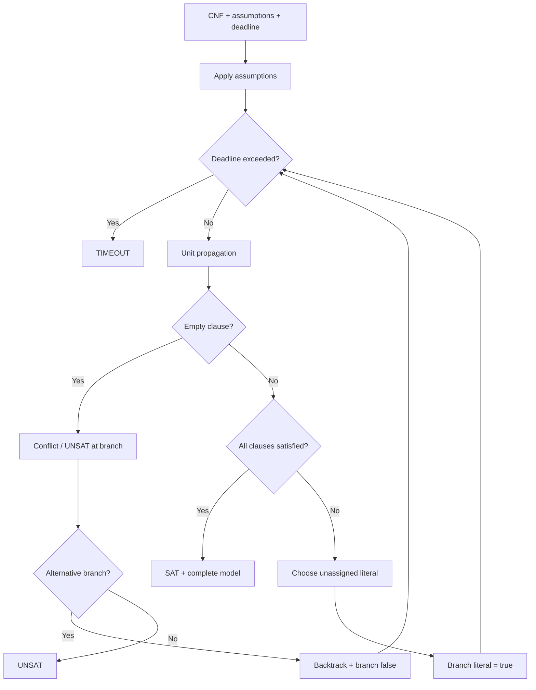

`DPLLSolver` chỉ làm việc với số nguyên đại diện literal và luôn trả **complete assignment** cho `1..cnf.num_vars` khi `status == SAT`. Mọi lớp phía trên gọi qua `SatSolver` Protocol; `CountingSolver` (`sat/solver.py`) bọc `SatSolver` để gom tổng số call, `decisions`, `propagations`, `backtracks`, `runtime_ms`. DPLL không import GUI, không đọc file puzzle và không biết khái niệm Criminal/Clue.

### 6.8. Build knowledge base công khai

**Module:** `reasoning/knowledge.py`, `reasoning/kb_builder.py`.

**Input:** tập clue đã reveal và verdict đã accepted.

**Output:** `PublicKnowledge` và CNF KB gồm clue clauses cộng unit clauses cho
verdict đã chứng minh.

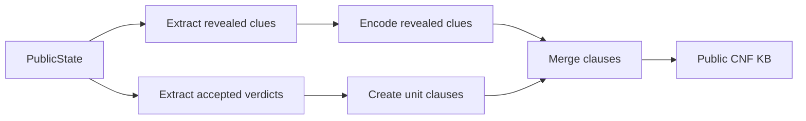

Clue chưa reveal không được đưa vào KB của Agent. Engine có thể sở hữu toàn bộ
clue, nhưng chỉ chuyển clue vừa được phép lộ sang `PublicKnowledge`.

### 6.9. Entailment và phân loại ô

**Module:** `reasoning/entailment.py`

**Chữ ký chính:**

- `check_kb_consistent(cnf_kb: CNF, solver: SatSolver, deadline: float | None = None) -> SatStatus`
- `classify(cnf_kb: CNF, var_id: int, solver: SatSolver, deadline: float | None = None) -> ClassifyOutcome`

Định nghĩa theo đề §3.4 (baseline bắt buộc 2 truy vấn):

```text
KB entails C_i      iff KB AND NOT C_i is UNSAT
KB entails NOT C_i  iff KB AND C_i is UNSAT
```

Kết quả (`ClassifyOutcome(classification, queries: tuple[SatQuery, ...])`):

- KB đầu wave là `UNSAT` -> `INCONSISTENT`; nếu quá `deadline` -> `TIMEOUT`;
- chỉ `NOT C_i` làm KB UNSAT -> `CRIMINAL`;
- chỉ `C_i` làm KB UNSAT -> `INNOCENT`;
- cả hai đều SAT -> `UNKNOWN`;
- cả hai đều UNSAT -> `INCONSISTENT`;
- một trong hai query trả `SatStatus.TIMEOUT` -> `TIMEOUT`.

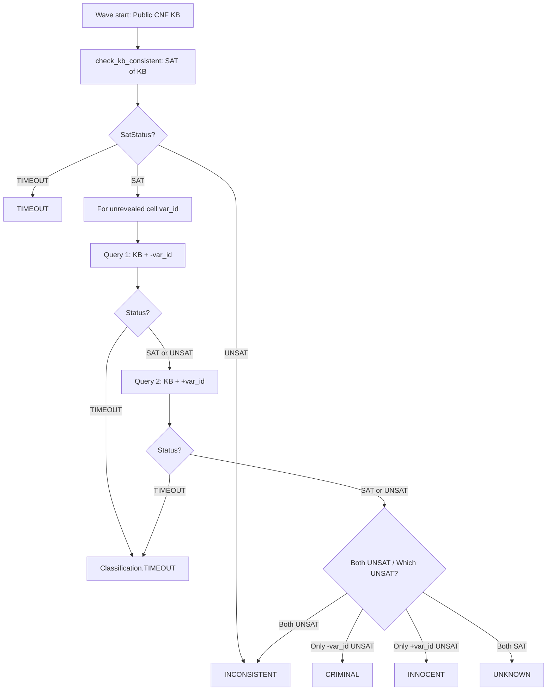

Từng query trong `ClassifyOutcome.queries` (`SatQuery(var_id, assumed_literal, status)`) được trả về cho Agent ghi vào `TraceStep.sat_queries` đúng theo yêu cầu PDF §4.4. Tối ưu 1-query dùng model `M` là phần mở rộng tùy chọn nếu cần benchmark thêm, không bắt buộc trong baseline.

### 6.10. Kiểm tra uniqueness

**Module:** `reasoning/uniqueness.py`

**Chữ ký chính:** `check_uniqueness(cnf: CNF, num_primary_vars: int, solver: SatSolver, deadline: float | None = None) -> UniquenessOutput`

**Input:** CNF đầy đủ của puzzle, `num_primary_vars` (`N*N`), `solver`, optional `deadline`.

**Output:** `UniquenessOutput(result: UniquenessResult, first_model: dict[int, bool] | None, stats: SolverStats)` với `UniquenessResult` thuộc `{UNIQUE, MULTIPLE, UNSAT, TIMEOUT}`.

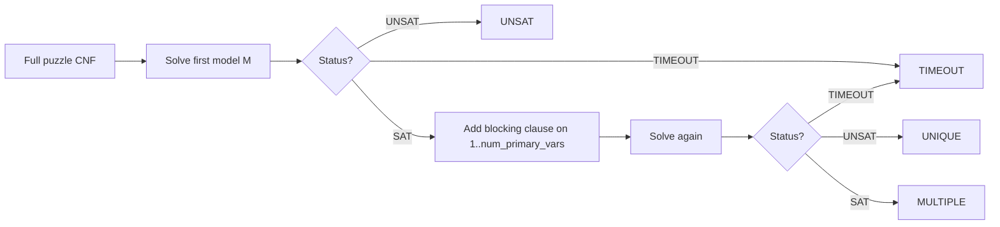

Blocking clause chỉ chặn đúng assignment của các biến chính `1..num_primary_vars`. Biến phụ (`> num_primary_vars`) có thể khác nhau nhưng không được làm một assignment nhân vật hợp lệ bị xem là nghiệm thứ hai.

### 6.11. Engine nhận verdict và reveal clue

**Module:** `engine/game_engine.py`

**Input:** `cell: Coord`, `status: Status` do người chơi hoặc Agent gửi qua `submit_verdict(cell, status)`.

**Output:** `VerdictOutcome(result: VerdictResult, cell: Coord, revealed_clue: Clue | None, public_state: PublicState, message: str = "")` (từ `domain/public_state.py`).

`GameEngine` đáp ứng đầy đủ interface `PublicGame` (`public_state()`, `submit_verdict()`) qua structural subtyping mà **không import `agent/`**, đồng thời cung cấp thêm `restart() -> PublicState` để khôi phục bàn chơi về trạng thái ban đầu **$KB_0$ (`initially_revealed`)**.

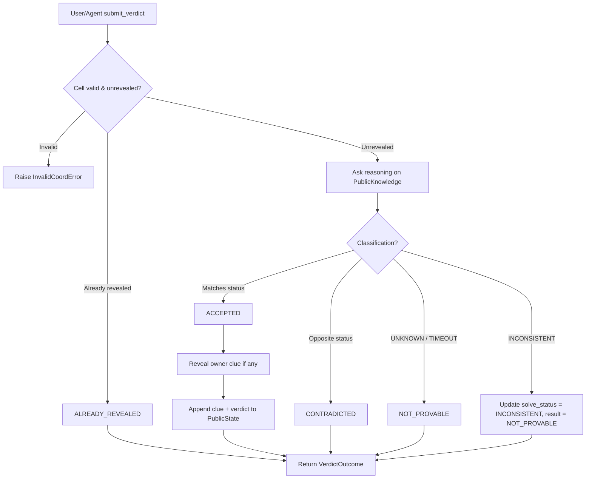

Engine không dùng `solution` để trả lời Agent hay kiểm chứng nước đi công khai. `solution` chỉ được dùng ở loader (khớp clue với solution) và kiểm tra cuối ván/oracle độc lập. Việc một verdict có được phép reveal hay không phải dựa vào reasoning trên dữ liệu công khai.

### 6.12. Hint

**Module:** `agent/hint.py`

**Chữ ký chính:** `suggest_hint(pk: PublicKnowledge, solver: SatSolver, deadline: float | None = None) -> Hint | None`

**Input:** `PublicKnowledge`, `solver`, optional `deadline`.

**Output:** `Hint(cell: Coord, suggested_status: Status, related_clue_ids: tuple[str, ...], reason: str)` hoặc `None` nếu chưa có ô forced (hoặc quá hạn).

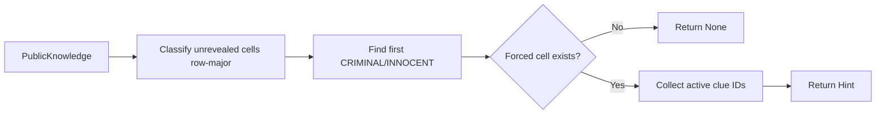

Hint chỉ được lấy từ ô đã được entailment chứng minh trên `PublicKnowledge`, chọn ô forced đầu tiên theo thứ tự **row-major**, không đọc `Puzzle.solution`.

### 6.13. Auto Solve và trace

**Module:** `agent/logic_agent.py`, `agent/trace.py`, `agent/ports.py`

**Input:** `game: PublicGame` (`agent/ports.py`, chỉ gồm `public_state()` và `submit_verdict(cell, status)`). `LogicAgent.__init__(self, solver: SatSolver)` tự bọc `solver` bằng `CountingSolver` nếu chưa bọc, bảo đảm mọi query của Agent (kể cả các query ra `UNKNOWN` và lệnh `check_kb_consistent` kiểm tra `SAT(KB)` ở đầu mỗi Wave) đều được đếm đầy đủ.

**Output:**
- `iter_steps(game, deadline=None) -> Iterator[AutoSolveStep]`: yield `AutoSolveStep(step, public_state, trace)` sau từng bước để GUI (`GameSession.auto_solve_steps`) cập nhật real-time.
- `run(game, deadline=None) -> SolveTrace`: tiêu thụ `iter_steps` và trả về `SolveTrace` cuối cùng với `SolveStatus` thuộc `{SOLVED, STUCK, INCONSISTENT, TIMEOUT}` (không dùng `FAILED`).

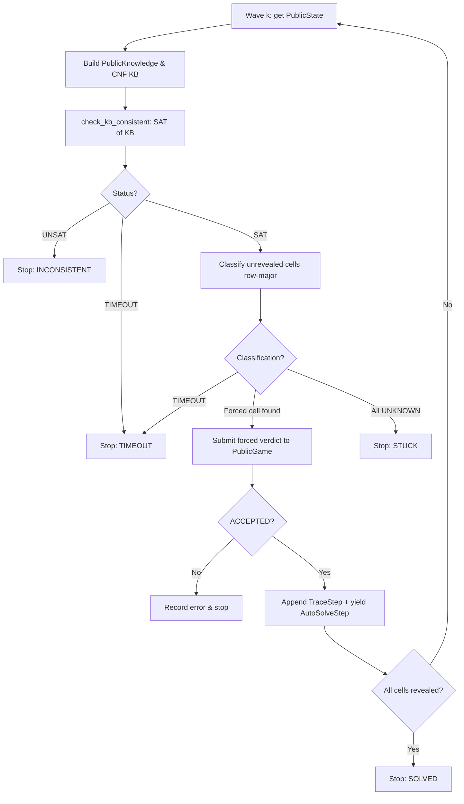

Mỗi `TraceStep` ghi lại đầy đủ thông tin theo PDF §4.4 (kèm danh sách `sat_queries` cụ thể chứ không chỉ số đếm):

```json
{
  "step": 3,
  "wave": 1,
  "cell": "B2",
  "classification": "INNOCENT",
  "active_clue_ids": ["c01", "c02"],
  "sat_queries": [
    {"coord": "B2", "assumed_status": "INNOCENT", "status": "SAT"},
    {"coord": "B2", "assumed_status": "CRIMINAL", "status": "UNSAT"}
  ],
  "verdict_result": "ACCEPTED",
  "revealed_clue_id": "c04",
  "runtime_ms": 1.8
}
```

### 6.14. GUI (PyQt6) render và điều phối qua `GameSession`

Ứng dụng chạy **desktop PyQt6** (`gui/`), giao tiếp trực tiếp với **`GameSession`** (`app/session.py`) trong cùng tiến trình Python — không dựng HTTP server hay Flask/FastAPI.

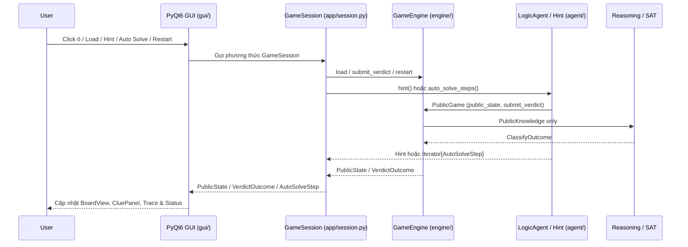

GUI có ba vùng hiển thị chính (kèm nhật ký/trace Auto Solve khi cần):

1. `BoardView`: ô, tọa độ, tên, nghề, mặt úp/ngửa, status (`CRIMINAL`/`INNOCENT`);
2. `CluePanel`: danh sách `revealed_clues` — tự render lời dẫn thân thiện từ `clue_type`, `owner` và tham số clue (không dùng trường `text` trong domain) — và highlight các ô trong `clue.cells()`;
3. `Controls/Status`: nút **Load** (mở `QFileDialog` trỏ mặc định vào `Source/puzzles/`), **Restart**, **Hint**, **Auto Solve** (duyệt `auto_solve_steps` qua `QTimer`/`QThread`), kết quả verdict và trace/lỗi.

GUI không tự tính logic và không import `engine`, `reasoning`, hay `sat`. Sau mỗi thao tác trên `GameSession`, GUI thay toàn bộ state hiển thị bằng `PublicState` trả về để tránh state UI và engine bị lệch.

## 7. Hợp đồng điều phối `GameSession` (`app/session.py`)

`GameSession` là lớp facade duy nhất (do Gia Hưng phụ trách) nối PyQt6 GUI với `GameEngine` và `LogicAgent`.

### 7.1. Load puzzle

```python
session.load_puzzle(path: str | Path) -> PublicState
```

GUI mở `QFileDialog` mặc định vào `Source/puzzles/` (nhưng người dùng hoặc giám khảo có thể chọn bất kỳ file JSON hợp lệ nào bên ngoài). `GameSession` gọi `loader.py` kiểm tra schema + khớp `solution`, khởi tạo `GameEngine` ở trạng thái **$KB_0$ (`initially_revealed`)** và trả về `PublicState`:

- `puzzle_id`: `"p01"`
- `size`: `3` (hoặc `4`, `5`)
- `cells`: `tuple[PublicCell, ...]` (chỉ gồm `coord`, `name`, `job`, `revealed`, `status`)
- `revealed_clues`: `tuple[Clue, ...]` (các clue của các ô trong `initially_revealed`)
- `solve_status`: `SolveStatus.RUNNING`

Nếu file lỗi schema, đường dẫn không tồn tại hoặc clue mâu thuẫn `solution`, loader ném `InvalidPuzzleError` để GUI hiện hộp thoại lỗi rõ ràng.

### 7.2. Trạng thái công khai (`PublicState`)

Mọi dữ liệu trả ra từ `GameSession` đều đi qua `PublicState`, không bao giờ chứa `solution`, `hidden_clues` hay dữ liệu mật tương đương.

### 7.3. Nộp verdict thủ công

```python
session.submit_verdict(cell: Coord, status: Status) -> VerdictOutcome
```

Trả về `VerdictOutcome(result, cell, revealed_clue, public_state, message)` với các nhánh `VerdictResult`:

- `ACCEPTED`: verdict được chứng minh bởi `PublicKnowledge`; ô chuyển sang `revealed=True`, `status` được ghi nhận, `revealed_clue` chứa `Clue` vừa lộ (nếu có) và `public_state` đã cập nhật.
- `NOT_PROVABLE`: chưa đủ cơ sở suy ra từ clue đã lộ (`UNKNOWN` hoặc reasoning bị `TIMEOUT`); `revealed_clue = None`, không lật ô.
- `CONTRADICTED`: ngược với trạng thái bị ép bởi `PublicKnowledge`; `revealed_clue = None`, giữ nguyên trạng thái ô và cảnh báo người chơi.
- `ALREADY_REVEALED`: ô đã mở trước đó (`revealed=True`); `revealed_clue = None`, không làm sai lệch state.

Cả hai nhánh từ chối (`NOT_PROVABLE`, `CONTRADICTED`) đều tuyệt đối không tiết lộ clue ẩn hay đáp án thật.

### 7.4. Hint

```python
session.hint() -> Hint | None
```

Chuyển `PublicKnowledge.from_public_state(engine.public_state())` cho `suggest_hint(...)`:

- Nếu tìm thấy ô forced (theo thứ tự row-major), trả `Hint(cell, suggested_status, related_clue_ids, reason="ENTAILED_BY_PUBLIC_KB")`.
- Nếu chưa có ô nào bị ép (hoặc reasoning bị timeout), trả `None` để GUI thông báo chưa thể gợi ý.

### 7.5. Auto Solve

```python
session.auto_solve_steps(timeout_ms: int | None = None) -> Iterator[AutoSolveStep]
```

- Chuyển `timeout_ms` thành `deadline` (`time.perf_counter() + timeout_ms / 1000.0`) nếu được đặt, rồi ủy quyền cho `LogicAgent.iter_steps(engine, deadline=deadline)`.
- Yield trực tiếp từng `AutoSolveStep(step: TraceStep | None, public_state: PublicState, trace: SolveTrace)` cho `QTimer` hoặc `QThread` trên PyQt6 để cập nhật bảng chơi và nhật ký trace theo từng bước.
- Kết thúc ở một trong các `SolveStatus`: `SOLVED`, `STUCK`, `INCONSISTENT`, hoặc `TIMEOUT`. Khi `TIMEOUT`, vẫn giữ nguyên `trace` và toàn bộ metrics (`total_sat_calls`, `total_decisions`, `total_propagations`, `total_backtracks`, `reveal_waves`, `total_runtime_ms`), tuyệt đối không xóa failure/timeout.

### 7.6. Restart

```python
session.restart() -> PublicState
```

Gọi `GameEngine.restart()`, khôi phục ván chơi về **$KB_0$ (`initially_revealed`)** của cùng puzzle đang nạp mà không cần GUI giữ `solution` hay đọc lại file.

## 8. Workflow thí nghiệm và output báo cáo

**Module:** `experiments/runner.py`, `experiments/metrics.py`, `experiments/export.py`, `experiments/validate_puzzle.py`.

Trước khi đưa puzzle vào benchmark, `experiments/validate_puzzle.py` kiểm tra offline tính **unique solution** và **no-guess solvable**. Sau đó `runner.py` lần lượt load các puzzle trong `Source/puzzles/` (`3x3`, `4x4`, và stress case `5x5`), chạy uniqueness, auto-solve với timeout và ghi đầy đủ cả thành công lẫn thất bại (`STUCK`, `INCONSISTENT`, `TIMEOUT`).

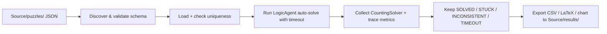

Mỗi puzzle phải có tối thiểu sáu nhóm chỉ số:

| Nhóm | Nội dung |
|---|---|
| Encoding | số biến chính, số biến phụ, số clause |
| SAT | số SAT call |
| DPLL | decisions, propagations, backtracks |
| Agent | số bước suy diễn, số reveal waves |
| Runtime | thời gian encode/solve/total |
| Outcome | `SOLVED`, `STUCK`, `INCONSISTENT`, `TIMEOUT`, hoặc lỗi validation |

Output đặt tại `Source/results/`:

```text
Source/results/
├── metrics.csv
├── metrics.tex
├── runtime_by_grid.png
└── traces/
    ├── 3x3_p01.json
    └── 4x4_p01.json
```

## 9. Mapping chức năng với file và I/O

| Chức năng | File chính | Input | Output |
|---|---|---|---|
| Kiểu dữ liệu/lưới/Clue ABC | `domain/*` (`types.py`, `grid.py`, `regions.py`, `clue.py`, `public_state.py`) | size, coord, region | value object / `Clue` ABC / `PublicState` / error |
| Parse & validate clue | `clues/parser.py`, `clues/validator.py` | dict/JSON | `Clue` |
| Đánh giá ngữ nghĩa | `clues/core.py`, `clues/extensions.py` | clue + assignment | `bool` |
| Map biến | `encoding/varmap.py` | coord/aux request | literal ID |
| Encode | `encoding/encoder.py`, `cardinality.py`, `clue_encoders.py` | clues | `(CNF, EncodingStats)` |
| DPLL & bộ đếm | `sat/dpll.py`, `sat/solver.py` | `CNF`, assumptions, deadline | `SatResult` + stats |
| KB | `reasoning/knowledge.py`, `kb_builder.py` | `PublicKnowledge` | `(CNF, VarMap, EncodingStats)` |
| Entailment | `reasoning/entailment.py` | `CNF`, `var_id`, `SatSolver` | `ClassifyOutcome` |
| Uniqueness | `reasoning/uniqueness.py` | full CNF, `num_primary_vars`, `SatSolver` | `UniquenessOutput` |
| Hint | `agent/hint.py` | `PublicKnowledge`, `SatSolver` | `Hint` hoặc `None` |
| Auto solve | `agent/logic_agent.py`, `agent/ports.py`, `agent/trace.py` | `PublicGame`, deadline | `Iterator[AutoSolveStep]` / `SolveTrace` |
| Verdict & reveal | `engine/game_engine.py`, `engine/loader.py` | `cell`, `status` | `VerdictOutcome` / `PublicState` |
| Điều phối facade | `app/session.py` (`GameSession`) | path / action / timeout | `PublicState` / `VerdictOutcome` / `Hint` / `Iterator[AutoSolveStep]` |
| Render PyQt6 | `gui/app.py`, `board_view.py`, `clue_panel.py`, `controls.py` | `PublicState` | PyQt6 UI |
| Experiment & offline check | `experiments/runner.py`, `validate_puzzle.py`, `export.py` | `Source/puzzles/` | `Source/results/` (CSV, LaTeX, PNG, traces) |

## 10. Kiểm thử và Definition of Done

### 10.1. Test bắt buộc (`Source/tests/`, cấu hình qua `Source/pytest.ini`)

Dùng chung `Source/tests/oracle.py` để kiểm chứng độc lập bằng brute-force ở quy mô nhỏ:

1. `test_dpll.py`: so sánh SAT/UNSAT của `DPLLSolver` với brute force trên CNF nhỏ (≤ 16 biến), kèm test `TIMEOUT`.
2. `test_encoder_vs_eval.py`: semantic `clue.evaluate()` và CNF tương đương trên mọi assignment biến chính ($N \le 4$), kiểm tra khả năng mở rộng biến phụ (cả nhánh direct và sequential counter fallback).
3. `test_entailment.py`: kiểm tra ví dụ `(A OR B) AND (NOT A OR B)` (`B` = `CRIMINAL`, `A` = `UNKNOWN`), đối chiếu 2-query với oracle brute-force trên board nhỏ và nhánh `INCONSISTENT` / `TIMEOUT`.
4. `test_uniqueness.py`: phân biệt `UNIQUE`, `MULTIPLE`, `UNSAT` (chỉ block biến chính `1..num_primary_vars`, không block biến phụ) và `TIMEOUT`.
5. `test_isolation.py`: `agent/` không import `griductive.engine`, `griductive.gui`, `griductive.app` (kiểm tra AST/module imports) và chạy `LogicAgent` với dynamic **`MockGame`** để xác nhận Agent không thể chạm vào `solution` hay clue ẩn.
6. PublicState & Session tests: mọi `PublicState` và `VerdictOutcome` từ `GameEngine` / `GameSession` chỉ chứa public fields; `NOT_PROVABLE`, `CONTRADICTED`, `ALREADY_REVEALED` không làm lộ clue ẩn; `restart()` khôi phục về đúng $KB_0$ (`initially_revealed`).

### 10.2. Definition of Done cho từng task

- Hàm/class có type hints và docstrings.
- Có unit test cho nhánh thành công và lỗi (chạy `pytest` trong `Source/`).
- Không dùng global state để truyền dữ liệu giữa GUI và solver.
- Không vi phạm dependency một chiều.
- Có thống kê cần thiết nếu task thuộc encoder, DPLL, reasoning, agent hoặc experiments.
- Đã kiểm tra `PublicState` / `VerdictOutcome` không chứa `solution` hay hidden clue.
- PR chỉ chứa một nhiệm vụ và dùng Conventional Commit theo `Process.md`.

## 11. Trình tự triển khai khuyến nghị

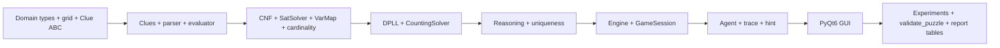

Mỗi mốc nên chạy test trước khi chuyển sang tầng tiếp theo. Đặc biệt phải chốt schema JSON, `VarMap`, `PublicState` và hợp đồng `GameSession` trước khi làm GUI để tránh thay đổi ngược gây lỗi tích hợp.

