# Griductive Solver - Workflow, Input/Output và API

Tài liệu này mô tả workflow kỹ thuật được suy ra từ `Analysis_Report.md`,
`Process.md` và yêu cầu trong `AI - Project 2.pdf`. Mục tiêu là thống nhất cách
các module nhận dữ liệu, xử lý và trả kết quả; đồng thời làm rõ cách GUI gọi API
và cập nhật màn hình.

## 1. Phạm vi và nguyên tắc bất biến

Griductive Solver giải puzzle trên lưới `N x N`, với `N` thuộc `3, 4, 5`.
Mỗi ô là một nhân vật có trạng thái `CRIMINAL` hoặc `INNOCENT`. Clue luôn đúng,
nhưng chỉ được lộ sau khi verdict của ô đã được chứng minh bởi knowledge base
hiện tại.

Các nguyên tắc bắt buộc:

1. Logic Agent chỉ nhận `PublicKnowledge`: clue đã lật và verdict đã được chứng
   minh. Agent không import `engine`, không đọc `solution` và không đọc danh sách
   thẻ đang úp.
2. CNF được sinh tự động từ clue, không hard-code riêng cho từng puzzle.
3. Semantic evaluator độc lập với encoder để kiểm thử chéo.
4. Biến nhân vật `C_i` và biến phụ `auxiliary` phải được cấp phát tách biệt.
5. Agent chỉ kết luận khi một trạng thái bị ép bởi entailment; không suy đoán từ
   model tùy ý.
6. API chỉ trả `PublicState`; tuyệt đối không serialize `solution`, clue chưa
   reveal hoặc thuộc tính ẩn của engine.

## 2. Kiến trúc và dependency flow

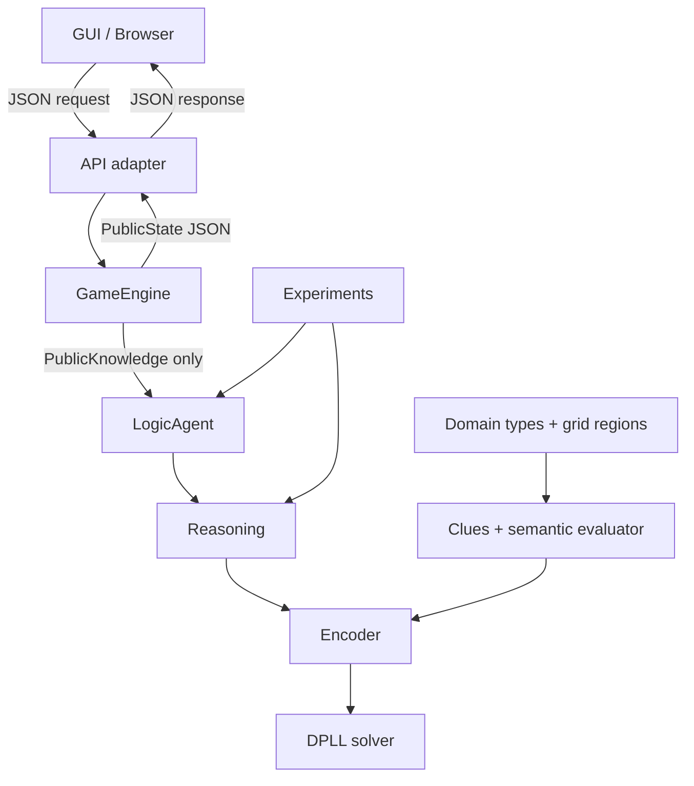

Luồng phụ thuộc một chiều:

```text
domain <- clues <- encoding <- sat
                         ^       ^
                         |       |
                    reasoning --+
                         ^
                       agent
                         ^
                       engine <- gui / experiments / main
```

`engine` được phép dùng `reasoning` để kiểm tra verdict, nhưng `agent` không
được phụ thuộc ngược vào `engine`. `PublicState` là biên giới dữ liệu duy nhất
giữa engine và phần còn lại của ứng dụng.

## 3. Cấu trúc thư mục đã tạo

```text
Griductive-Solver/
├── AI - Project 2.pdf
├── Analysis_Report.md
├── Process.md
├── Workflow.md
├── Source/
│   ├── main.py
│   ├── README.md
│   ├── requirements.txt
│   └── griductive/
│       ├── domain/
│       │   ├── types.py
│       │   ├── grid.py
│       │   ├── regions.py
│       │   └── errors.py
│       ├── clues/
│       │   ├── base.py
│       │   ├── core.py
│       │   ├── extensions.py
│       │   ├── validator.py
│       │   └── parser.py
│       ├── sat/
│       │   ├── cnf.py
│       │   ├── dpll.py
│       │   └── stats.py
│       ├── encoding/
│       │   ├── varmap.py
│       │   ├── cardinality.py
│       │   ├── clue_encoders.py
│       │   ├── encoder.py
│       │   └── stats.py
│       ├── reasoning/
│       │   ├── knowledge.py
│       │   ├── kb_builder.py
│       │   ├── entailment.py
│       │   └── uniqueness.py
│       ├── agent/
│       │   ├── logic_agent.py
│       │   ├── hint.py
│       │   └── trace.py
│       ├── engine/
│       │   ├── puzzle.py
│       │   ├── loader.py
│       │   ├── game_engine.py
│       │   └── public_state.py
│       ├── gui/
│       │   ├── app.py
│       │   ├── board_view.py
│       │   ├── clue_panel.py
│       │   ├── controls.py
│       │   └── assets/
│       └── experiments/
│           ├── runner.py
│           ├── metrics.py
│           └── export.py
├── puzzles/
│   ├── 3x3/
│   ├── 4x4/
│   └── 5x5/
├── results/
└── tests/
    ├── test_dpll.py
    ├── test_encoder_vs_eval.py
    ├── test_entailment.py
    ├── test_uniqueness.py
    └── test_isolation.py
```

Các file `.py` hiện là skeleton có docstring; phần workflow dưới đây là hợp
đồng cần dùng khi triển khai từng file.

## 4. Hợp đồng dữ liệu chung

### 4.1. Kiểu dữ liệu chính

| Kiểu | Giá trị | Ý nghĩa |
|---|---|---|
| `Status` | `CRIMINAL`, `INNOCENT` | Trạng thái của một ô |
| `Classification` | `CRIMINAL`, `INNOCENT`, `UNKNOWN`, `INCONSISTENT` | Kết quả entailment |
| `VerdictResult` | `ACCEPTED`, `NOT_PROVABLE`, `CONTRADICTED` | Kết quả người chơi nộp verdict |
| `SolveStatus` | `RUNNING`, `SOLVED`, `FAILED`, `TIMEOUT` | Trạng thái auto-solve/thí nghiệm |

Coordinate dùng chuỗi như `A1`, `B2`, `C3`. `row-major` là thứ tự cố định để
ánh xạ biến:

```text
var_id(A1) = 1
var_id(B1) = 2
...
var_id(A2) = N + 1
```

Biến phụ bắt đầu sau toàn bộ biến chính và chỉ được `VarMap` cấp phát; không
được trùng với biến nhân vật.

### 4.2. Schema puzzle JSON đề xuất

```json
{
  "id": "p01",
  "size": 3,
  "characters": [
    {"cell": "A1", "name": "Abel", "job": "Detective"}
  ],
  "solution": {
    "A1": true,
    "B1": false
  },
  "clues": [
    {
      "id": "clue-01",
      "owner": "A1",
      "type": "EXACTLY",
      "region": {"kind": "row", "index": 1},
      "k": 1
    }
  ]
}
```

`solution` chỉ được loader và engine giữ trong bộ nhớ. API không được trả trường
này. Puzzle trước khi chạy phải thỏa:

- đúng `size * size` ô;
- mọi ô/clue/region hợp lệ;
- mọi clue đúng với solution ẩn;
- toàn bộ clue có đúng một nghiệm khi chạy uniqueness check.

## 5. Workflow tổng thể từ input đến output

```mermaid
flowchart LR
    J[Puzzle JSON] --> L[Loader]
    L --> V[Validate puzzle + clue]
    V --> P[Puzzle in engine]
    P --> PS[Initial PublicState]
    PS --> U[GUI renders board]
    U --> Q[User click / Hint / Auto Solve]
    Q --> R[JSON API request]
    R --> E[Engine or Agent]
    E --> K[PublicKnowledge]
    K --> C[Build CNF]
    C --> D[DPLL]
    D --> T[Entailment / verdict]
    T --> O[Public JSON response]
    O --> U
```

GUI không gọi thẳng `DPLL`, `solution` hoặc các class nội bộ của engine. GUI chỉ
gọi API adapter; adapter gọi engine/agent rồi chuyển kết quả thành JSON công
khai.

## 6. Workflow và I/O của từng chức năng

### 6.1. Load và validate puzzle

**Module:** `engine/loader.py`

**Input:** đường dẫn file JSON hoặc object JSON.

**Xử lý:** đọc schema, parse coordinate, tạo clue, kiểm tra range của `k`, vùng
tham chiếu, kích thước lưới, tính đúng của clue và uniqueness.

**Output:** `Puzzle` hợp lệ hoặc lỗi `InvalidPuzzleError` kèm danh sách lỗi.

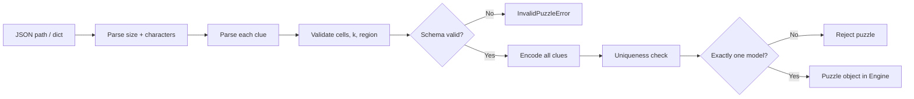

GUI gọi `POST /api/puzzles/load` với `{ "path": "puzzles/3x3/p01.json" }`.
GUI nhận `200` cùng `PublicState` ban đầu, hoặc `400` với `code` và `message`
để hiển thị lỗi.

### 6.2. Parse clue và semantic evaluator

**Module:** `clues/parser.py`, `clues/core.py`, `clues/extensions.py`.

Mỗi clue phải triển khai:

```python
clue.cells() -> tuple[Coord, ...]
clue.evaluate(assign: dict[Coord, bool]) -> bool
```

Evaluator không gọi encoder. Nó tính trực tiếp ngữ nghĩa clue trên phép gán
Boolean, nhờ đó có thể dùng làm oracle trong `test_encoder_vs_eval.py`.

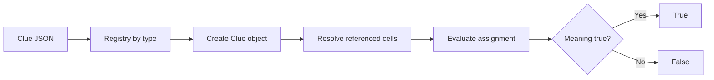

Các clue core:

| Type | Input chính | Evaluator |
|---|---|---|
| `FACT` | `cell`, `status` | `assign[cell] == status` |
| `SAME` | `left`, `right` | Hai Boolean bằng nhau |
| `DIFFERENT` | `left`, `right` | Hai Boolean khác nhau |
| `EXACTLY` | `k`, `region` | `sum(assign[c]) == k` |
| `AT_LEAST` | `k`, `region` | `sum(assign[c]) >= k` |
| `AT_MOST` | `k`, `region` | `sum(assign[c]) <= k` |

Extension nên triển khai tối thiểu hai loại trong các loại sau:

- `PARITY`: số Criminal trong vùng là chẵn/lẻ;
- `COMPOUND`: AND/OR/NOT của các clue con;
- `COMPARE_COUNT`: số Criminal ở `region_left` lớn hơn/nhỏ hơn/bằng
  `region_right`.

### 6.3. Sinh region

**Module:** `domain/regions.py`

**Input:** kích thước lưới và mô tả vùng.

**Output:** tuple coordinate không trùng nhau, nằm trong lưới.

```mermaid
flowchart LR
    A[Region spec] --> B{kind}
    B -- row --> C[row(index)]
    B -- column --> D[column(index)]
    B -- neighbors --> E[8 directions - center]
    B -- explicit --> F[explicit cells]
    C --> G[Bounds + duplicate check]
    D --> G
    E --> G
    F --> G
    G --> H[tuple Coord]
```

### 6.4. Ánh xạ biến `VarMap`

**Module:** `encoding/varmap.py`

**Input:** kích thước lưới, coordinate, yêu cầu biến phụ.

**Output:** ID biến chính cho từng ô và ID biến phụ mới.

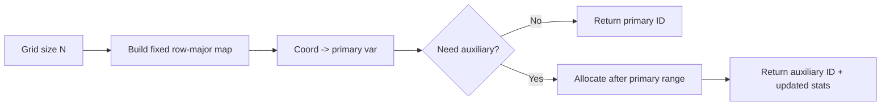

Không được cấp phát biến ngẫu nhiên theo thứ tự dictionary. Map cố định giúp
trace, DIMACS, báo cáo và test có kết quả tái lập.

### 6.5. Encode clue thành CNF

**Module:** `encoding/clue_encoders.py`, `encoding/encoder.py`.

**Input:** danh sách `Clue`, `VarMap`.

**Output:** `CNF` và `EncodingStats` gồm `primary_vars`, `aux_vars`, `clauses`.

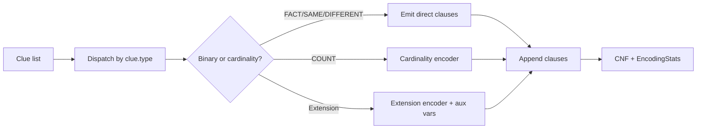

Ví dụ `DIFFERENT(A1, B1)`:

```text
(C_A1 OR C_B1) AND (NOT C_A1 OR NOT C_B1)
```

Với `EXACTLY(k, R)`, có thể dùng direct encoding cho vùng nhỏ. Với vùng lớn
hoặc `COMPARE_COUNT`, dùng sequential counter/totalizer để tránh liệt kê toàn
bộ `2^|R|` phép gán.

### 6.6. Cardinality encoding

**Module:** `encoding/cardinality.py`

**Input:** danh sách literal chính, `k`, loại ràng buộc.

**Output:** các clause CNF và các auxiliary literal nếu cần.

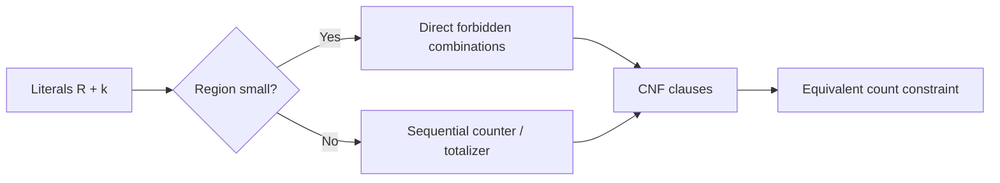

Kiểm chứng bắt buộc: với mọi assignment của biến chính, CNF có khả năng mở
rộng bằng biến phụ khi và chỉ khi `clue.evaluate(assignment)` là `True`.

### 6.7. DPLL solver

**Module:** `sat/dpll.py`

**Input:** `CNF`, optional assumptions là list literal.

**Output:** `SatResult`:

```json
{
  "sat": true,
  "model": {"1": true, "2": false},
  "stats": {
    "decisions": 2,
    "propagations": 5,
    "backtracks": 1,
    "runtime_ms": 0.42
  }
}
```

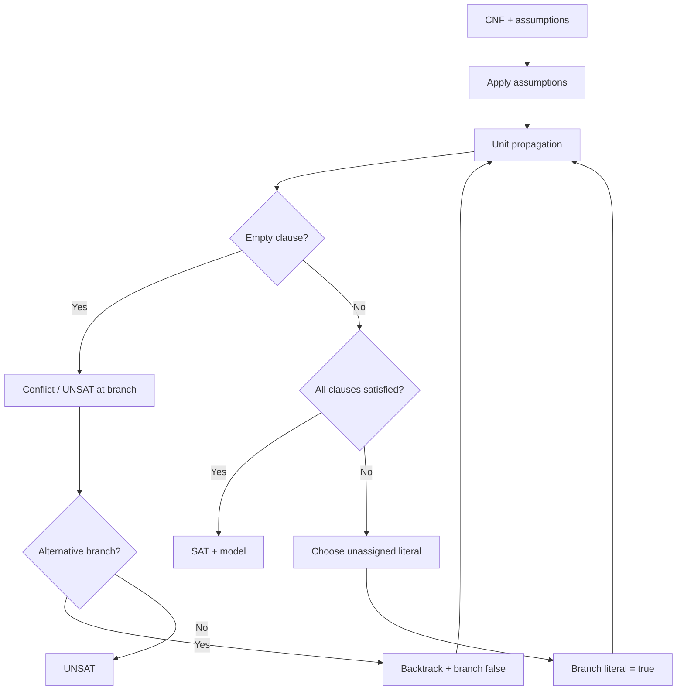

DPLL chỉ làm việc với số nguyên đại diện literal. Nó không import GUI, không
đọc file puzzle và không biết khái niệm Criminal/Clue.

### 6.8. Build knowledge base công khai

**Module:** `reasoning/knowledge.py`, `reasoning/kb_builder.py`.

**Input:** tập clue đã reveal và verdict đã accepted.

**Output:** `PublicKnowledge` và CNF KB gồm clue clauses cộng unit clauses cho
verdict đã chứng minh.

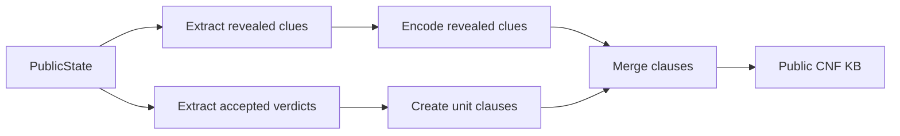

Clue chưa reveal không được đưa vào KB của Agent. Engine có thể sở hữu toàn bộ
clue, nhưng chỉ chuyển clue vừa được phép lộ sang `PublicKnowledge`.

### 6.9. Entailment và phân loại ô

**Module:** `reasoning/entailment.py`

Định nghĩa:

```text
KB entails C_i      iff KB AND NOT C_i is UNSAT
KB entails NOT C_i  iff KB AND C_i is UNSAT
```

Kết quả:

- chỉ `C_i` bị ép -> `CRIMINAL`;
- chỉ `NOT C_i` bị ép -> `INNOCENT`;
- cả hai đều SAT -> `UNKNOWN`;
- cả hai đều UNSAT hoặc KB ban đầu UNSAT -> `INCONSISTENT`.

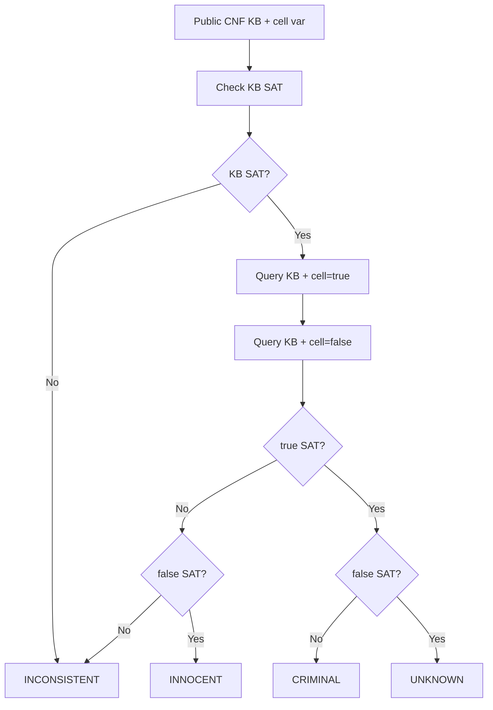

Tối ưu được phép dùng: lấy một model `M` của KB, sau đó kiểm tra một counter-
model `KB AND (C_i != M[i])` cho mỗi ô. UNSAT nghĩa là ô bị ép theo `M[i]`;
SAT nghĩa là ô còn UNKNOWN. Dù dùng tối ưu hay hai query chuẩn, kết quả phải
giống nhau.

### 6.10. Kiểm tra uniqueness

**Module:** `reasoning/uniqueness.py`

**Input:** CNF đầy đủ của puzzle và danh sách biến chính.

**Output:** `UNIQUE`, `MULTIPLE`, hoặc `UNSAT` cùng model đầu tiên nếu có.

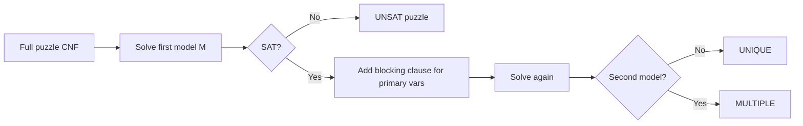

Blocking clause chỉ chặn đúng assignment của các biến chính. Biến phụ có thể
khác nhau nhưng không được làm một assignment nhân vật hợp lệ bị xem là nghiệm
thứ hai.

### 6.11. Engine nhận verdict và reveal clue

**Module:** `engine/game_engine.py`

**Input:** `cell`, `status` do người chơi hoặc Agent gửi.

**Output:** `VerdictResult`, public card state, và clue mới nếu verdict được
chấp nhận.

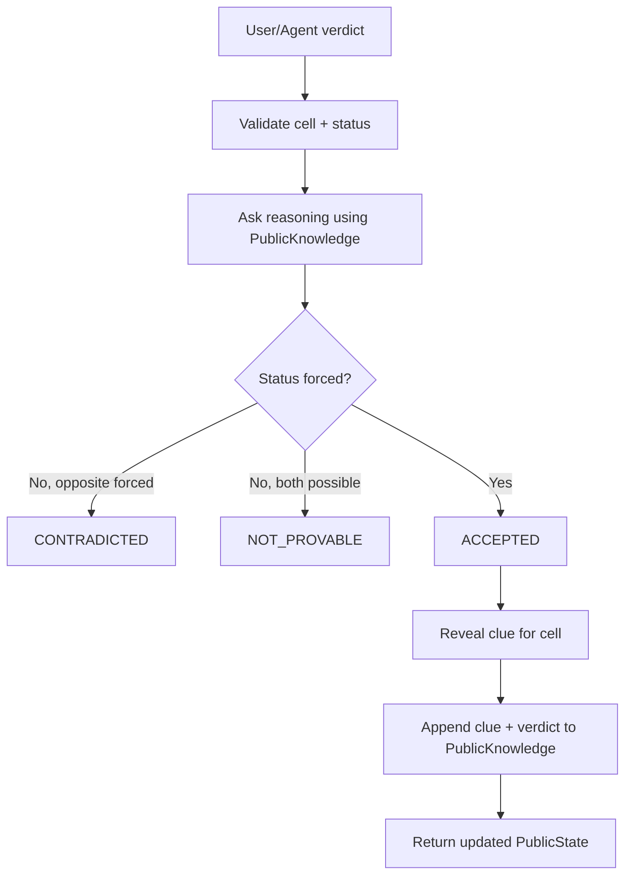

Engine không dùng `solution` để trả lời Agent. `solution` chỉ được dùng ở lớp
engine cho việc kiểm tra tính đúng cuối cùng, hoặc ở loader để xác nhận puzzle
được tạo hợp lệ. Việc một verdict có được phép reveal hay không phải dựa vào
reasoning trên dữ liệu công khai.

### 6.12. Hint

**Module:** `agent/hint.py`

**Input:** `PublicKnowledge`, trạng thái các ô đã reveal.

**Output:** hint gồm ô được đề xuất, trạng thái bị ép, clue liên quan và trace
ngắn; không trả solution ẩn.

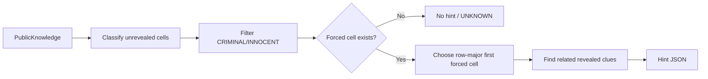

Hint chỉ được lấy từ các cell đã được entailment chứng minh. Không được chọn
trạng thái bằng cách đọc `Puzzle.solution`.

### 6.13. Auto Solve và trace

**Module:** `agent/logic_agent.py`, `agent/trace.py`

**Input:** public state ban đầu và một interface engine chỉ có các thao tác công
khai như `get_public_state`, `submit_verdict`.

**Output:** `Trace` gồm từng bước, số SAT call, verdict, clue được reveal, wave,
trạng thái cuối và số liệu runtime.

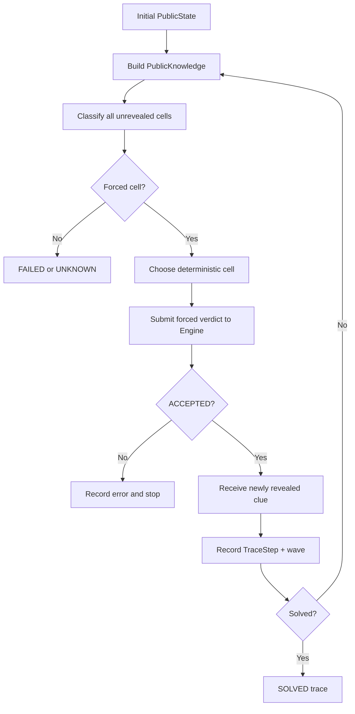

Một `TraceStep` nên có tối thiểu:

```json
{
  "step": 3,
  "cell": "B2",
  "classification": "INNOCENT",
  "sat_calls": 2,
  "revealed_clue_id": "clue-07",
  "wave": 1,
  "runtime_ms": 1.8
}
```

### 6.14. GUI render và gọi API

API có thể dùng Flask/FastAPI hoặc một adapter tương đương. Workflow không phụ
thuộc framework; hợp đồng JSON mới là phần bắt buộc.

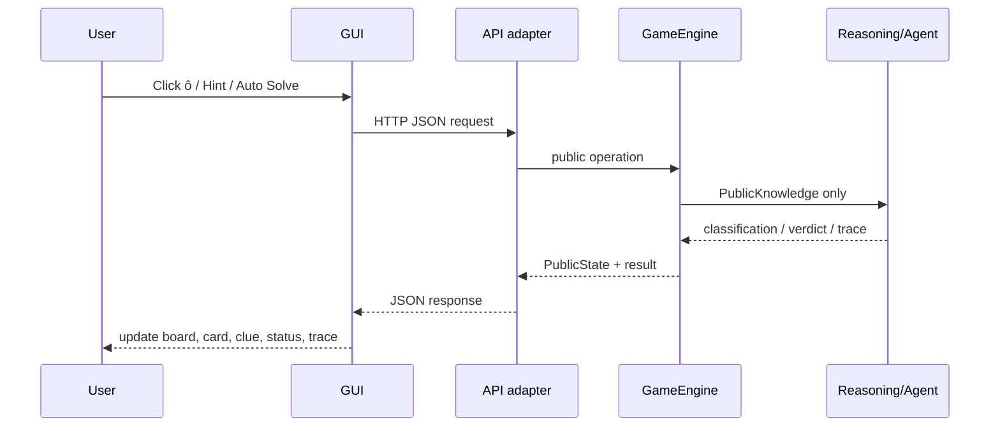

GUI có ba vùng hiển thị:

1. `BoardView`: ô, tọa độ, tên, nghề, mặt úp/ngửa, status;
2. `CluePanel`: danh sách clue đã reveal và highlight các ô trong `clue.cells()`;
3. `Controls/Status`: Load, Restart, Hint, Auto Solve, verdict result và lỗi.

GUI không tự tính logic. Sau mỗi response, GUI thay toàn bộ state hiển thị bằng
`public_state` trả về để tránh state cũ và state engine bị lệch.

## 7. API JSON đề xuất

### 7.1. Load puzzle

```http
POST /api/puzzles/load
Content-Type: application/json
```

```json
{"path": "puzzles/3x3/p01.json"}
```

Response `200`:

```json
{
  "ok": true,
  "public_state": {
    "puzzle_id": "p01",
    "size": 3,
    "cells": [
      {"cell": "A1", "name": "Abel", "job": "Detective", "revealed": false, "status": null}
    ],
    "revealed_clues": [],
    "game_status": "RUNNING"
  }
}
```

Response lỗi `400`:

```json
{
  "ok": false,
  "error": {"code": "INVALID_PUZZLE", "message": "size must be 3, 4, or 5"}
}
```

### 7.2. Lấy public state

```http
GET /api/state
```

Response `200` là `PublicState`. Không có `solution`, `hidden_clues` hoặc trường
ẩn tương đương.

### 7.3. Nộp verdict thủ công

```http
POST /api/verdict
Content-Type: application/json
```

```json
{"cell": "B2", "status": "CRIMINAL"}
```

Response `200`:

```json
{
  "ok": true,
  "result": "ACCEPTED",
  "cell": "B2",
  "revealed_clue": {
    "id": "clue-07",
    "type": "SAME",
    "cells": ["B2", "C2"]
  },
  "public_state": {}
}
```

Nếu chưa chứng minh được:

```json
{
  "ok": true,
  "result": "NOT_PROVABLE",
  "cell": "B2",
  "public_state": {}
}
```

Nếu verdict ngược với trạng thái đang bị ép:

```json
{
  "ok": true,
  "result": "CONTRADICTED",
  "cell": "B2",
  "public_state": {}
}
```

Hai kết quả từ chối đều không được trả clue ẩn.

### 7.4. Hint

```http
POST /api/hint
```

Response:

```json
{
  "ok": true,
  "hint": {
    "cell": "A2",
    "suggested_status": "INNOCENT",
    "reason": "ENTAILED_BY_PUBLIC_KB",
    "related_clues": ["clue-02", "clue-05"]
  }
}
```

Nếu chưa có ô forced, trả `hint: null` và lý do `NO_FORCED_CELL`.

### 7.5. Auto Solve

```http
POST /api/auto-solve
Content-Type: application/json
```

```json
{"timeout_ms": 10000, "step_mode": true}
```

Response có thể trả trace hoàn chỉnh hoặc stream từng bước tùy GUI:

```json
{
  "ok": true,
  "solve_status": "SOLVED",
  "trace": [],
  "metrics": {
    "sat_calls": 18,
    "decisions": 7,
    "propagations": 31,
    "backtracks": 2,
    "reveal_waves": 5,
    "runtime_ms": 12.4
  },
  "public_state": {}
}
```

Timeout phải trả `TIMEOUT` và metrics hiện có; không xóa failure khỏi kết quả.

### 7.6. Restart

```http
POST /api/restart
```

Engine tạo public state mới từ cùng puzzle, xóa `PublicKnowledge` và reset trace.
Không cần gửi solution từ GUI.

## 8. Workflow thí nghiệm và output báo cáo

**Module:** `experiments/runner.py`, `metrics.py`, `export.py`.

Runner lần lượt load puzzle 3x3, 4x4 và stress case 5x5, chạy uniqueness,
auto-solve với timeout và ghi cả thành công lẫn failure/timeout.

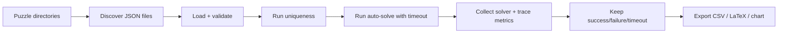

Mỗi puzzle phải có tối thiểu sáu nhóm chỉ số:

| Nhóm | Nội dung |
|---|---|
| Encoding | số biến chính, số biến phụ, số clause |
| SAT | số SAT call |
| DPLL | decisions, propagations, backtracks |
| Agent | số bước suy diễn, số reveal waves |
| Runtime | thời gian encode/solve/total |
| Outcome | `SOLVED`, `FAILED`, `TIMEOUT`, hoặc lỗi validation |

Output đề xuất:

```text
results/
├── metrics.csv
├── metrics.tex
├── runtime_by_grid.png
└── traces/
    ├── 3x3_p01.json
    └── 4x4_p01.json
```

## 9. Mapping chức năng với file và I/O

| Chức năng | File chính | Input | Output |
|---|---|---|---|
| Kiểu dữ liệu/lưới | `domain/*` | size, coordinate | value object/region/error |
| Parse clue | `clues/parser.py` | dict/JSON | `Clue` |
| Đánh giá ngữ nghĩa | `clues/core.py`, `extensions.py` | clue + assignment | `bool` |
| Map biến | `encoding/varmap.py` | coord/aux request | literal ID |
| Encode | `encoding/encoder.py` | clues | CNF + stats |
| DPLL | `sat/dpll.py` | CNF + assumptions | `SatResult` |
| KB | `reasoning/kb_builder.py` | public knowledge | CNF KB |
| Entailment | `reasoning/entailment.py` | KB + cell | classification |
| Uniqueness | `reasoning/uniqueness.py` | full CNF | unique/multiple/unsat |
| Hint | `agent/hint.py` | public knowledge | hint/null |
| Auto solve | `agent/logic_agent.py` | public engine interface | trace/status |
| Verdict | `engine/game_engine.py` | cell + status | result + public state |
| Render | `gui/board_view.py` | public state | visual board |
| Experiment | `experiments/runner.py` | puzzle paths | metrics/results |

## 10. Kiểm thử và Definition of Done

### 10.1. Test bắt buộc

1. `test_dpll.py`: so sánh SAT/UNSAT của DPLL với brute force trên CNF nhỏ.
2. `test_encoder_vs_eval.py`: semantic evaluator và CNF tương đương trên mọi
   assignment phù hợp; có kiểm tra khả năng tồn tại biến phụ.
3. `test_entailment.py`: kiểm tra ví dụ
   `(A OR B) AND (NOT A OR B)`, trong đó `B` là Criminal và `A` là Unknown;
   kiểm tra thêm `INCONSISTENT`.
4. `test_uniqueness.py`: phân biệt một nghiệm, nhiều nghiệm và không có nghiệm.
5. `test_isolation.py`: agent không import `griductive.engine` và không truy cập
   field solution.
6. API tests: mọi response chỉ có public fields; verdict từ chối không làm lộ
   clue.

### 10.2. Definition of Done cho từng task

- Hàm/class có type hints và docstrings.
- Có unit test cho nhánh thành công và lỗi.
- Không dùng global state để truyền dữ liệu giữa GUI và solver.
- Không vi phạm dependency một chiều.
- Có thống kê cần thiết nếu task thuộc encoder, DPLL, reasoning, agent hoặc
  experiments.
- Đã kiểm tra public response không chứa `solution`/hidden clue.
- PR chỉ chứa một nhiệm vụ và dùng Conventional Commit theo `Process.md`.

## 11. Trình tự triển khai khuyến nghị

```mermaid
flowchart LR
    A[Domain types + grid] --> B[Clues + parser + evaluator]
    B --> C[CNF + VarMap + cardinality]
    C --> D[DPLL + stats]
    D --> E[Reasoning + uniqueness]
    E --> F[Engine + public state]
    F --> G[Agent + trace + hint]
    G --> H[GUI/API adapter]
    H --> I[Experiments + report tables]
```

Mỗi mốc nên chạy test trước khi chuyển sang tầng tiếp theo. Đặc biệt phải chốt
schema JSON, `VarMap` và API public state trước khi làm GUI để tránh thay đổi
ngược gây lỗi tích hợp.

